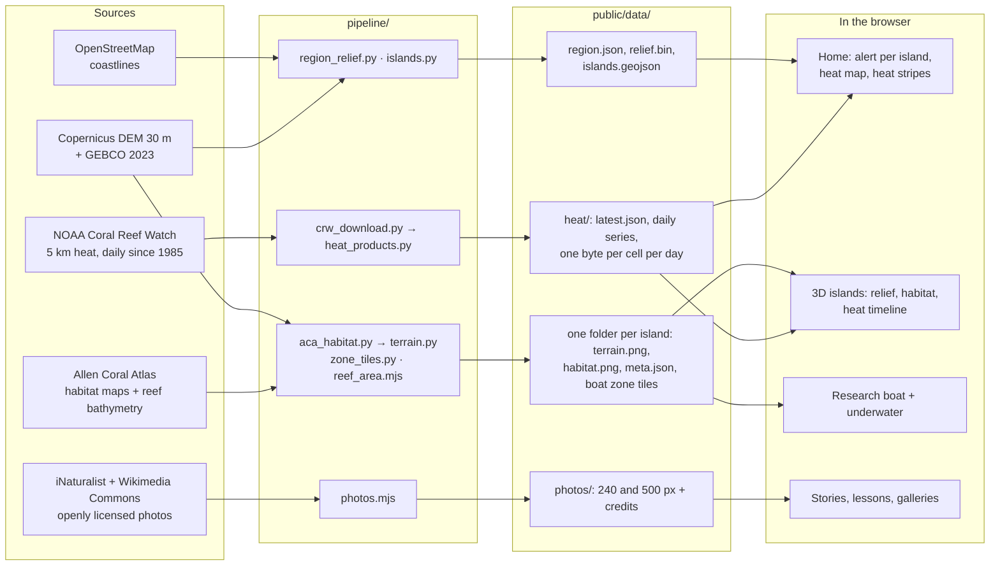

<p align="center">
  <a href="https://reefquest.todosenlaweb.com">
    
  </a>
</p>

<p align="center">
  <a href="https://reefquest.todosenlaweb.com"></a>
  <a href="LICENSE"></a>
  <a href="https://todosenlaweb.com"></a>
  <a href="https://nerdypunk.dev"></a>
  <br>
  
  
  
  
  <br>
  
  
  
  
  
  
  
</p>

**ReefQuest** is a free, bilingual 3D web experience about the coral reefs of the **Bay Islands of
Honduras**: Roatán, Utila, Guanaja and Cayos Cochinos. It takes open satellite and survey data and
turns it into something a student in Roatán, a dive shop in Utila or a visitor on the ferry can
explore on an old phone: how much heat the reef has taken this year and in every year since 1985,
what lives where on the seafloor, and what that looks like from a research boat and underwater.

It's built for Honduran schools, island communities, dive shops and visitors. Every dataset is
credited where it is shown, and every fact in the stories and lessons has its source.

## What you can do

- **See the latest heat on the reef.** The home page shows each island's most recent NOAA alert
  level, a map of 5 km heat cells, and 42 years of heat as stripes. The data is updated by a script,
  not fetched live, so every figure carries its date.
- **Fly over each island in 3D.** Real relief and reef shelf, habitat maps, depth contours and the
  heat overlay, with a timeline you can scrub or play from 1985 to the latest satellite day. As the heat builds, the
  water warms in color and coral areas pale.
- **Take the research boat out.** Sail a stylized survey vessel over detailed reef zones, map the
  seafloor with its multibeam sonar, watch the echo sounder, lower the CTD, and keep a logbook.
- **Dive.** Drop underwater among 11 kinds of Caribbean reef life placed by habitat and depth, with a
  field guide to what is nearby.
- **Find things.** Whale sharks off Utila, met by the island's own encounter guidelines (go in
  slowly, stay out of the feeding frenzy); sea turtles, reef sharks, and three shipwrecks on the
  seafloor. Each one stands for something documented at that place, and its story has the sources.
- **Learn.** Short explainers on corals, bleaching and degree heating weeks, stories from real
  places (each one sourced), and 71 openly licensed photos of the islands' reefs.

## From data to picture

ReefQuest is a static site: a set of Python and Node scripts (`pipeline/`) turn open datasets into
small files committed to `public/data/` (about 22 MB), and the browser only ever reads those. No
third-party server is called while you use it.



### Heat: degree heating weeks



<sub>Roatán, one stripe per year, colored by that year's peak degree heating weeks on NOAA's alert
scale (blue: no stress, orange: warning, red to purple: Alert 1 to Alert 5). Generated from the same
`latest.json` the home page reads.</sub>

NOAA Coral Reef Watch measures how much heat has built up in the ocean surface: **degree heating
weeks** (DHW, in °C-weeks): over the last 12 weeks, how far the water stayed above its usual
warmest-month temperature, counting only days at least 1 °C above it. From 4 °C-weeks NOAA expects
significant bleaching (Alert 1), from 8 severe bleaching and significant coral death (Alert 2); the
scale goes up to Alert 5 at 20.

- `crw_download.py` fetches every year of the 5 km global product for the Bay Islands box from
  NOAA's ERDDAP server (PacIOOS). The 42 years take a few minutes each.
- `heat_products.py` turns those into small files: for each island, the daily mean of the 5 km cells
  inside a box around it; for each year, a grid of 16 × 28 cells per day stored as **one byte per
  cell** (DHW × 10), so a whole year is about 160 KB; and `latest.json`, a few KB for the home page.
- In the browser, the alert level is computed from DHW with NOAA's thresholds (`src/lib/alert.ts`).
  The 3D water draws the 5 km cells as a texture that follows the timeline day by day, from nearly
  clear below 4 °C-weeks to a slow pulse from Alert 2; coral areas whiten and corals underwater
  bleach by species from about 4 to 10 °C-weeks, and the fog shifts toward wine with the area's
  heat. These effects are **illustrative**, and the site says so: the heat is a regional 5 km
  satellite signal, not a measurement on any one reef.

### Relief and seafloor

- `terrain.py` joins three sources into one height map per island: **Copernicus DEM** (30 m) on
  land, **Allen Coral Atlas satellite bathymetry** over the reef (down to about 20 m, smoothed), and
  **GEBCO 2023** (about 450 m) farther out, only to connect the reef to deep water.
- Heights are packed into the red and green channels of a PNG (`h = (R × 256 + G) / 10 − 3000` m),
  so the browser decodes the terrain from an ordinary image. In 3D, land relief is exaggerated ×4
  and depths beyond 40 m are compressed so the reef shelf and the deep wall both read.
- The terrain mesh is denser on land and the reef shelf than over deep water, which keeps an island
  at a few hundred thousand triangles on computers and about 130–160 thousand on phones.

### Habitat

- `aca_habitat.py` pulls the **Allen Coral Atlas v2.0** classes from Google Earth Engine: benthic
  (sand, rubble, rock, seagrass, coral/algae, microalgal mats) and geomorphic (reef crest, back reef,
  lagoon…) plus the reef mask, packed into the three channels of `habitat.png`.
- The terrain shader colors the seafloor naturally by those classes (with surf on the reef crest),
  or, with the "Habitat map" layer on, draws them as a chart: each point lets the 3 × 3 cells
  around it vote with smooth weights, so class edges become rounded curves instead of pixels.
- For the boat, `zone_tiles.py` cuts detailed tiles (10 m relief, 5 m habitat) around each place,
  loaded only when you board there. The reef life you meet underwater is chosen by these classes and
  depth.
- `reef_area.mjs` measures each island's mapped reef on the same maps (about 123 km² around Roatán,
  72 around Guanaja, 42 around Utila) for the islands page.

### The rest

- **Coastlines:** OpenStreetMap, simplified by `islands.py`; they outline the home map.
- **Regional relief:** a 175 × 100 GEBCO grid and its depth contours (`region_relief.py`), drawn as
  the islands seen from the sky in the site's footer.
- **Photos:** `photos.mjs` downloads a hand-picked list from iNaturalist and Wikimedia Commons,
  keeping each photo's author, license and source, and decides from each photo's own coordinates
  whether it was taken at the place it illustrates.

More detail, setup and gotchas: [`pipeline/README.md`](pipeline/README.md). The full project spec:
[`docs/HANDOFF.md`](docs/HANDOFF.md).

## Built to run on an old phone

The first view is under ~5 MB and each island scene loads only when opened. Devices fall into
three quality tiers (low-end phones and old PCs, other phones and tablets, desktops) that set mesh
detail, effects and frame rate; the 3D views redraw only when something changes, and drop canvas
resolution if frames get slow. Without WebGL the site falls back to the 2D map and charts.
Animations stop with the system's reduced-motion setting.

## Stack

Vite + TypeScript + React 19, three.js through React Three Fiber and drei, zustand for state,
Motion for interface animation, all CSS hand-written. Fonts: Inter, Instrument Serif and IBM Plex
Mono, self-hosted. Hosted as static assets on a Cloudflare Worker.

## Develop

Node 24.

```bash
npm install
npm run dev        # http://localhost:5181
npm run build      # typecheck + production build (.cloudflare/output/v0/)
npm run typecheck
```

The committed `public/data/` is complete, so the site never needs the pipeline. To refresh the
heat data: `python pipeline/crw_download.py --all`, then `python pipeline/heat_products.py`
(see [`pipeline/README.md`](pipeline/README.md) for the Python setup). Pushing to `main` deploys
through Cloudflare Workers Builds.

```text
src/
  pages/      home, islands, heat, learn, data & credits
  scenes/     the 3D island: terrain, shaders, HUD, timeline
  boat/       the research boat, sonar, underwater reef life
  content/    stories, lessons and the field guide, every fact with its source
  ui/         shared components (galleries, buttons, transitions, the sky-view footer)
  i18n/       es.json and en.json
pipeline/     data scripts (Python + two Node scripts)
public/data/  what the site reads
brand/        logo, icons, social cards, this README's figures
```

## Data and credits

| Dataset | Used for | License |
| --- | --- | --- |
| [NOAA Coral Reef Watch](https://coralreefwatch.noaa.gov/product/5km/index.php) v3.1, 5 km | Daily sea temperature and degree heating weeks since 1985 | Public domain |
| [Allen Coral Atlas](https://allencoralatlas.org/) v2.0 | Habitat maps and reef bathymetry | CC BY 4.0 |
| [Copernicus DEM GLO-30](https://dataspace.copernicus.eu/explore-data/data-collections/copernicus-contributing-missions/collections-description/COP-DEM) | Island relief | Free use with attribution |
| [GEBCO 2023 Grid](https://www.gebco.net/) | Open-ocean depth | Public domain with attribution |
| [OpenStreetMap](https://www.openstreetmap.org/copyright) | Island outlines | ODbL 1.0 |
| [iNaturalist](https://www.inaturalist.org/) and [Wikimedia Commons](https://commons.wikimedia.org/) | Photos | Each photo's own CC license, credited on the site |

Full citations are on the site's **Data & credits** page. NC-licensed photos are used because
ReefQuest is free and nonprofit. Site-level survey data (AGRRA, Healthy Reefs) is cited in stories,
not republished.

**Please read the caveats:** heat stress is a regional 5 km satellite signal, the reef scenes are a
model and not a navigation chart, and the bleaching shown follows the heat as an illustration, not
an observation.

---

<p align="center">
  An <a href="https://github.com/saintmikenode/reefquest">open source</a> project by
  <a href="https://nerdypunk.dev">NerdyPunkDev</a>, part of
  <a href="https://todosenlaweb.com">Todos en la Web</a>. Code under the MIT License.
</p>
