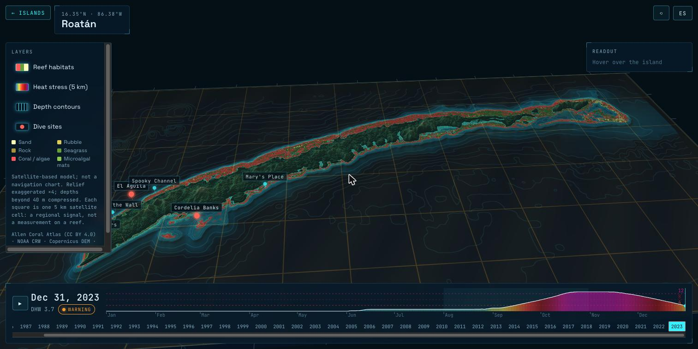
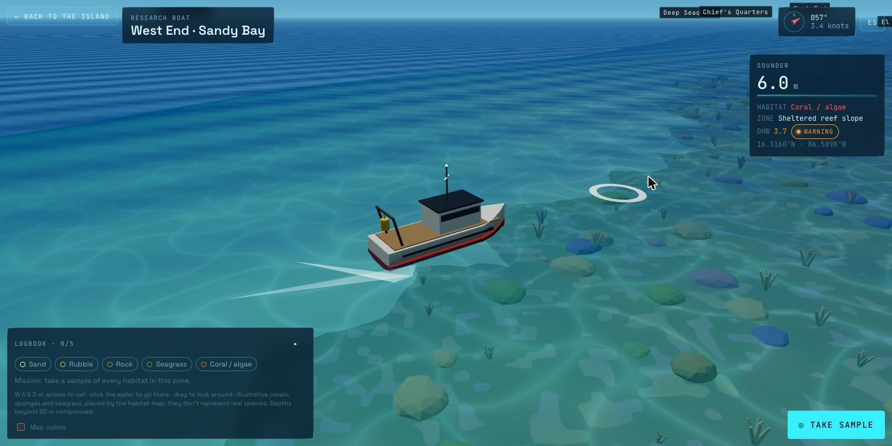

# Phase 1 report: Roatán MVP (overnight build)

November 20, 2026. Built locally; **nothing is committed, pushed or deployed.** Preview: the
`reefquest` config in `.claude/launch.json` (port 5181), then open http://localhost:5181.

## What's there

**Home (`#/`)**: "Ocean heat, seen from space". A live SVG map of the archipelago with real
OpenStreetMap coastlines and today's NOAA 5 km heat cells; a readout panel (hottest island today,
record year); four island cards with today's DHW, NOAA alert level, sea temperature, a 120-day
sparkline and each island's worst year; and "heat stripes": the yearly maximum heat stress per
island since 1985. Roatán opens in 3D; the other three show data now and "3D coming soon".

**Roatán in 3D (`#/island/roatan`)**: the scene is real data end to end:

- Land: Copernicus DEM (30 m), with 20 m topographic lines and hillshade.
- Seafloor: the Allen Coral Atlas satellite bathymetry over the reef (0–19 m), faded into GEBCO
  deep water (the trench north of Roatán, compressed so it doesn't swallow the reef).
- Reef habitats in the Atlas's colors (coral/algae, seagrass, sand, rock, rubble), depth contours,
  animated light caustics in the shallows and a glowing shoreline.
- The sea surface shows NOAA's actual 5 km cells for the chosen day, colored on NOAA's alert scale.
- Timeline 1985 → today: year chips (heat-event years outlined), a chart of the year's heat with
  the bleaching season shaded, a scrubber, and ▶ playback through the decades.
- Live readout under the cursor: lat/lon, elevation or depth, habitat class, reef zone, DHW and
  alert level at that spot.
- Pins: four stories (Flowers Bay: SCTLD's first Honduran record; Cordelia Banks: 46% → 5% live
  coral after 2023, jumps the timeline to the heat peak; West End: pillar coral, critically
  endangered; El Aguila wreck) and five dive sites from the Roatán Marine Park mooring list. Every
  story cites its sources.
- Layer toggles, a habitat legend, the caveats ("not a navigation chart", "5 km regional signal",
  exaggeration), credits in the panel, a one-time "how to move" hint, reset view, ES/EN.

**Utila and Guanaja in 3D (`#/island/utila`, `#/island/guanaja`)**: built overnight with the same
pipeline. Guanaja's 400 m mountains inside its barrier-reef ring, and Utila's flat island with the
southwest cays, both with habitat colors and heat cells. Their shallow depths are estimated from
the reef zones until we download their Atlas bathymetry (the scene says so). No story pins yet.

**Research boat (new)**: from a story card ("Explore by boat") or the layers panel, you sail a
procedural research vessel over detailed tiles of the reef: West End · Sandy Bay, Cordelia Banks and
Mary's Place on Roatán (real Atlas bathymetry), plus the richest coral areas of Utila and Guanaja
(picked automatically from the habitat map; depths estimated). Tap the water (phones) or use
WASD / arrows; the camera follows and can orbit. You see the reef through clear water (shallows
turquoise, depth fading to blue along the line of sight), foam on the reef crest, illustrative
corals, sponges, seagrass and fish placed by the real habitat map, and buoys at the real moorings
(arriving at a story buoy opens its story). A sounder shows depth, habitat, reef zone and heat
stress under the boat; "Take sample" fills a logbook, and sampling every habitat in the zone
completes the mission. It runs aground in water shallower than ~1 m. Boat code is a 9 KB lazy chunk;
each zone tile is 100–420 KB.

**Heat stress (`#/heat`)**: our island-level comparison (NOAA doesn't publish one): a chart of
all four islands for any year, the worst years per island (peak DHW, days ≥ 4, days ≥ 8), heat
stripes, and NOAA's full alert scale with its official impact wording.

**Learn (`#/learn`)**: seven short explainers for teenagers: bleaching, degree heating weeks,
2023, SCTLD, the 2024 reef health report card, why reefs matter (tourism, fishing, storm
protection), coral restoration. All sourced.

**Data & credits (`#/about`)**: five plain-language caveats, every dataset with its citation and
license, software and fonts.

## Size and performance

| What | Download (compressed) |
| --- | --- |
| First screen (app, CSS, fonts, map and status data) | ~150 KB |
| Opening Roatán in 3D (3D engine + terrain + habitat + heat data) | ~1.3 MB more |
| Each extra year on the timeline | ~30 KB |

Well under the 5 MB budget. Phones with ≤ 6 cores or ≤ 4 GB memory get "lite" mode (quarter
of the mesh vertices, no caustic animation, lower resolution); add `?lite` to any URL to try it.
The scene only redraws when something changes, which saves battery.

## Facts checked overnight (with sources in the app)

- NOAA's current alert scale (Alert Levels 1–5, updated Dec 2023). The app derives the level from
  DHW; NOAA also requires same-day HotSpot ≥ 1 °C, so ours is an approximation (said on the
  credits page).
- SCTLD: first recorded 24 Sep 2020 at Flowers Bay; ~155 m/day spread (Truc et al. 2023).
- Cordelia Banks: 46% → 5% live coral, Sep 2023 → Feb 2024 (Healthy Reefs).
- 2024 report card: MAR "poor" (2.5); Roatán 2.8 "fair", 22% coral, 19% macroalgae.
- Pillar coral: IUCN Critically Endangered (Dec 2022).

## Still running / not done

- **Full heat history**: the NOAA download is ~40% done (PacIOOS is slow tonight, one transient
  failure retried). Until it finishes, the years 1991–2022 are filled with placeholder values and
  "today" shows Dec 31, 2023. When it completes I rebuild the heat files; if you read this first,
  run `~/.venvs/reefquest/bin/python pipeline/crw_download.py --all` then `heat_products.py` from
  the `pipeline/` folder and restart the dev server.
- Coral photogrammetry models: not started (needs your downloads/permission decision).
- **Cayos Cochinos 3D: blocked.** The Earth Engine copy of the Allen Coral Atlas has no habitat
  classes there (only the reef outline), so the scene would have no reef colors. It stays "coming
  soon" until you download its Atlas package (it includes benthic and geomorphic maps): same steps
  as Roatán, uploading `pipeline/areas/cayos-cochinos.geojson`. Then I'll read the habitat from the
  download instead of Earth Engine.
- Utila and Guanaja: their Atlas bathymetry downloads (upload `pipeline/areas/utila.geojson` and
  `guanaja.geojson`) will replace the estimated shallow depths.
- Not tested on a real low-end Android phone yet; tested in desktop Chrome and a phone-size emulator.
- The phone portrait camera (looking along the island from its west tip) is implemented but I
  couldn't see it in a true portrait window; please check on your phone.

## Decisions for you

1. Commit this work (it's all local and uncommitted)?
2. Deploy? That creates the `reefquest` Worker and `reefquest.todosenlaweb.com` (only on your word).
3. Coral models: buy the paid ones / ask the photographer, or start with the CC-licensed pillar coral?
4. Branding: stand-alone (as built: its own coral logo and "instrument" look) or part of a series
   with CopánQuest?
